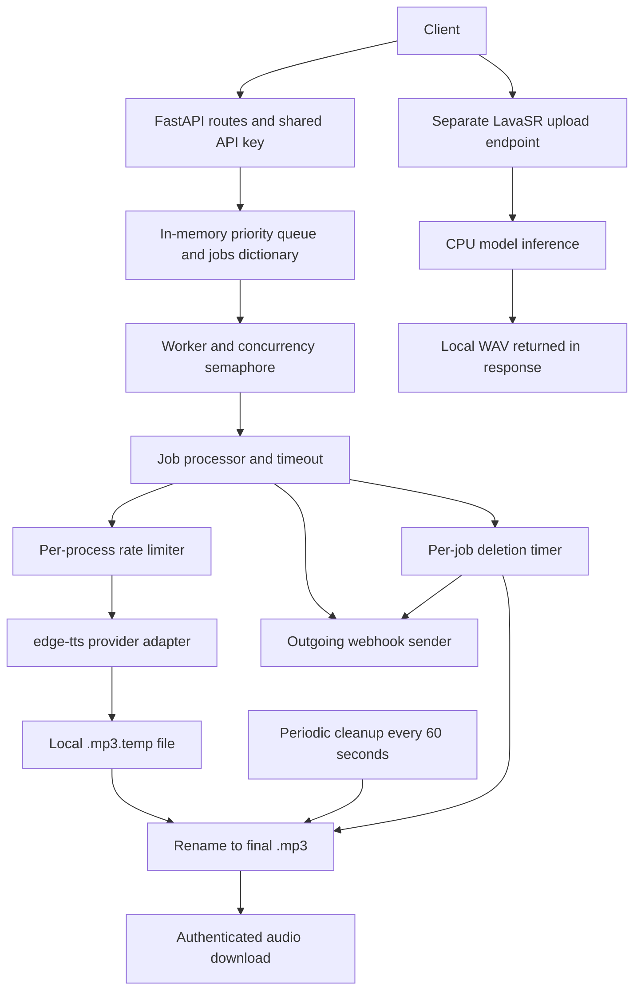

# Speechma HTTP API and architecture reference

Source repository: `https://github.com/Harinderpreet/tts-api.git`  
Reviewed commit: `46f156f9aad9cadcf397a7e5f04e2ec1ebd6bcb2`  
Review date: 2026-10-13

This document describes the checked-in implementation for migration to another framework. It was prepared by reading source code; no service, tests, dependency installation, or live requests were run. Example IDs, timestamps, durations, and hostnames are illustrative. Configuration defaults below are source defaults, not verified deployment settings.

## 1. Services, URLs, and authentication

The repository contains **two independent FastAPI applications**:

| Service | Entry point | Purpose |
| --- | --- | --- |
| TTS backend | `backend/main.py` → `app` | Queue speech generation, report status, serve/delete MP3 files, send outgoing webhooks |
| LavaSR | `lavasr/main.py` → `app` | Receive an uploaded audio file and return enhanced WAV audio synchronously |

Both Dockerfiles run HTTP on port `8000` inside their respective containers. There is no TLS certificate configuration or reverse-proxy routing in this repository. An HTTPS hostname and any public path prefix must come from the deployment configuration.

**The TTS source routes start at `/tts`, not `/api/tts`.** Do not add or remove a deployed prefix during migration without checking the proxy/client configuration. This document uses `https://tts.example.com` and `https://enhance.example.com` only as placeholders for the two service base URLs; it does not assert a production hostname.

Every explicitly declared application endpoint, including `/health`, requires:

```http
api-key: YOUR_API_KEY
```

The supplied value is compared with that service's `API_KEY` environment variable. Startup fails if the variable is missing. The header name is case-insensitive. This is a shared service credential; the source has no per-user authentication, ownership, or access filtering.

For a wrong key, both apps explicitly return HTTP `403`:

```json
{"detail":"Invalid API key"}
```

Missing-key responses are generated by FastAPI's `APIKeyHeader(auto_error=True)`, rather than a custom handler. The TTS requirements pin FastAPI `0.115.12`; the LavaSR Dockerfile installs FastAPI without pinning its version, despite a separate requirements snapshot. Verify the exact missing-key response against the chosen framework/version when reproducing it.

JSON request endpoints use `Content-Type: application/json`. Responses are JSON except audio downloads and framework documentation pages. GET and DELETE endpoints below have no request body and no declared query parameters.

## 2. Endpoint inventory

| Service | Method | Source path | Input | Success response |
| --- | --- | --- | --- | --- |
| TTS | POST | `/tts` | JSON speech request | `200` JSON with `job_id` |
| TTS | GET | `/tts/status/{job_id}` | Path `job_id` | `200` JSON status |
| TTS | GET | `/tts/audio/{job_id}` | Path `job_id` | `200` binary MP3 |
| TTS | DELETE | `/tts/audio/{job_id}` | Path `job_id` | `200` JSON message |
| TTS | GET | `/tts/jobs` | None | `200` JSON array, at most 50 records |
| TTS | GET | `/health` | None | `200` JSON health statistics, including on handled failure |
| LavaSR | POST | `/enhance-audio` | Multipart file and options | `200` binary WAV |

There is **no incoming webhook endpoint**. Webhooks are outgoing POST requests to the global `WEBHOOK_URL` configured on the TTS service. There are no custom endpoints for listing voices, cancelling jobs, editing jobs, changing settings, or retrieving request logs.

Both apps also leave FastAPI's default documentation routes enabled: `GET /openapi.json`, `GET /docs`, `GET /redoc`, and `GET /docs/oauth2-redirect`. They return generated OpenAPI JSON, HTML documentation, or an OAuth redirect helper, respectively. They are framework-provided routes, not the application endpoints covered by the global dependency in the same way. Their exact output follows the installed FastAPI version and is not a custom business contract.

## 3. Create a speech job — POST /tts

### Input schema

All five declared values are strings. Only `text` is required. Optional here means a field may be omitted; the public model does not declare nullable fields.

| Field | Type | Required | Default | Meaning |
| --- | --- | --- | --- | --- |
| `text` | string | Yes | — | Text to synthesize; leading/trailing whitespace is removed before queueing |
| `voice` | string | No | `"en-US-AriaNeural"` | Edge TTS voice identifier |
| `pitch` | string | No | `"0"` | Pitch adjustment; converted into a signed Hz value |
| `speed` | string | No | `"1"` | Speed multiplier; `"1"` is the baseline |
| `volume` | string | No | `"100"` | Volume value relative to a baseline of 100 |

Equivalent JSON Schema for the declared field types and defaults (custom text checks follow below):

```json
{
  "type": "object",
  "required": ["text"],
  "properties": {
    "text": {"type": "string"},
    "voice": {"type": "string", "default": "en-US-AriaNeural"},
    "pitch": {"type": "string", "default": "0"},
    "speed": {"type": "string", "default": "1"},
    "volume": {"type": "string", "default": "100"}
  }
}
```

The model does not configure rejection of extra fields. There is no supported per-request `webhook_url`, priority, output format, or client-supplied `job_id` field.

Text validation happens in two layers:

1. The request model rejects raw text longer than `MAX_TEXT_LENGTH` (default 50,000) and text whose stripped value is empty. These are framework validation errors, HTTP `422`.
2. The route checks for empty/whitespace-only text, at least one Unicode alphanumeric character (`str.isalnum()`), and stripped length between `MIN_TEXT_LENGTH` (default 2) and `MAX_TEXT_LENGTH`. Route checks return HTTP `400`. The model normally catches empty/whitespace-only input before the route runs.

The raw-length check occurs before trimming. A long string with excessive surrounding whitespace can therefore fail even if its trimmed content fits.

No explicit allowed voice list or numeric ranges are enforced by the public model. Conversion/provider failures can occur asynchronously after a job ID has been returned. Do not invent ranges when porting this contract.

### Parameter conversion

The worker converts the submitted strings before calling `edge_tts.Communicate`:

| Public field | Conversion | Example |
| --- | --- | --- |
| `pitch` | Append `Hz`, adding a leading `+` if no sign is present; `"0"` becomes `"+0Hz"` | `"-5"` → `"-5Hz"` |
| `speed` | `int((float(speed) - 1) * 100)`, formatted as a signed percentage | `"1.25"` → `"+25%"` |
| `volume` | `int(float(volume)) - 100`, formatted as a signed percentage | `"80"` → `"-20%"` |

Python `int()` truncates toward zero. These formulas, including floating-point behavior, are part of the current implementation. Submit values such as `"1.25"`, not provider-formatted values such as `"+25%"`.

### Output schema — HTTP 200

```ts
type CreateJobResponse = {
  job_id: string; // Server-generated UUID v4 string
};
```

Submission is asynchronous. HTTP `200` means accepted into memory, not that synthesis has completed. The code does not return `201` or `202`.

### Example

```bash
curl -X POST 'https://tts.example.com/tts' \
  -H 'api-key: YOUR_API_KEY' \
  -H 'Content-Type: application/json' \
  --data '{"text":"Hello from Speechma.","voice":"en-US-AriaNeural","pitch":"0","speed":"1","volume":"100"}'
```

```json
{"job_id":"9f7645d0-3bd2-4d21-a821-d864c63ad4ef"}
```

### Errors

- `422`: model/body validation failure, including missing `text`, invalid field types, raw text too long, or blank text.
- `400`: route-level text validation failure.
- `503`: waiting queue size is strictly greater than `MAX_CONCURRENT_REQUESTS * 2` before adding the job. This is not a total active-job limit.
- `500`: unexpected submission error.
- Authentication errors described above also apply.

Example HTTP `400`:

```json
{"detail":{"message":"Text must contain alphanumeric characters (not just punctuation like '...' or '!!!')"}}
```

Example HTTP `503` with the default concurrency of 50:

```json
{"detail":{"message":"Server is currently at capacity. Please try again later.","queue_size":101}}
```

## 4. Read job status — GET /tts/status/{job_id}

### Input schema

`job_id`: required path string. IDs generated by the service are UUIDs, but this route declares a plain string and does not validate UUID syntax.

### Output schema — HTTP 200

```ts
type JobStatusResponse = {
  job_id: string;
  status: "queued" | "processing" | "completed" | "failed";
  message: string;
};
```

These are the values produced by current code; the response model itself declares `status` as a plain string.

The route checks for an MP3 file first. An existing file produces `completed` regardless of in-memory state. Otherwise it reads the in-memory job. It does not return processing duration, the original request, an audio URL, or the stored failure reason.

| State returned | Current message |
| --- | --- |
| `processing` | `Audio is being processed` |
| `queued`, `completed`, or `failed` | `Audio is ready` |

The queued/failed message is a current implementation defect. Clients should use `status` rather than the message to determine readiness.

### Example

```bash
curl 'https://tts.example.com/tts/status/9f7645d0-3bd2-4d21-a821-d864c63ad4ef' \
  -H 'api-key: YOUR_API_KEY'
```

```json
{
  "job_id":"9f7645d0-3bd2-4d21-a821-d864c63ad4ef",
  "status":"processing",
  "message":"Audio is being processed"
}
```

Errors: `404` if there is neither a final MP3 nor an in-memory job; `500` for unexpected status-read errors. After cleanup, the API normally returns `404`, not a persistent `deleted` status.

```json
{"detail":{"message":"Job 9f7645d0-3bd2-4d21-a821-d864c63ad4ef not found","job_id":"9f7645d0-3bd2-4d21-a821-d864c63ad4ef"}}
```

## 5. Download speech — GET /tts/audio/{job_id}

### Input schema

`job_id`: required path string. No body or declared query parameters.

### Output schema — HTTP 200

Binary MP3 bytes, streamed in chunks of up to 1 MiB. There is no JSON wrapper, base64 encoding, or custom download filename header.

Application-specified headers:

```http
Content-Type: audio/mpeg
Content-Length: <file size in bytes>
Cache-Control: public, max-age=86400
ETag: "<Python hash(job_id)>"
```

The ETag comes from Python's string hash, not the audio content, and is not a stable cross-process identifier. The route does not explicitly implement range requests or conditional `304` handling.

### Example

```bash
curl 'https://tts.example.com/tts/audio/9f7645d0-3bd2-4d21-a821-d864c63ad4ef' \
  -H 'api-key: YOUR_API_KEY' \
  --output speech.mp3
```

Errors:

- `404`: final file does not exist, including a job still in progress or already deleted.
- `422`: file exists but is smaller than 100 bytes.
- `500`: errors caught while preparing the response. Errors during streaming may interrupt an already-started response rather than become JSON.

```json
{"detail":{"message":"Audio for job 9f7645d0-3bd2-4d21-a821-d864c63ad4ef not found or not ready yet","job_id":"9f7645d0-3bd2-4d21-a821-d864c63ad4ef"}}
```

## 6. Delete speech — DELETE /tts/audio/{job_id}

### Input schema

`job_id`: required path string. No body or declared query parameters.

### Output schema — HTTP 200

```ts
type DeleteAudioResponse = { message: string };
```

The route deletes the MP3 immediately, then schedules removal of the in-memory job as a response background task. It does not cancel queued/running synthesis and does not emit a deletion webhook. There must already be a final MP3 for the request to succeed.

### Example

```bash
curl -X DELETE 'https://tts.example.com/tts/audio/9f7645d0-3bd2-4d21-a821-d864c63ad4ef' \
  -H 'api-key: YOUR_API_KEY'
```

```json
{"message":"Audio for job 9f7645d0-3bd2-4d21-a821-d864c63ad4ef deleted successfully"}
```

Errors: `404` if the final file is absent, including repeated deletion; `500` if deletion fails.

## 7. List recent jobs — GET /tts/jobs

### Input schema

None. No supported pagination, status filter, or caller-selected limit.

### Output schema — HTTP 200

A top-level array containing up to 50 entries, sorted by descending `created_at` string. Two record shapes are mixed:

```ts
type FileBackedJob = {
  job_id: string;
  status: "completed";
  audio_exists: true;
  created_at: string; // Local ISO timestamp from file modification time, no timezone
  file_size: number;  // Integer bytes
};

type MemoryJob = {
  job_id: string;
  status: "queued" | "processing" | "completed" | "failed";
  audio_exists: false;
  created_at: string; // Local ISO timestamp from job creation time, no timezone
  text: string;      // First 100 characters, followed by "..." if longer
};

type ListJobsResponse = Array<FileBackedJob | MemoryJob>;
```

An MP3-backed job has `file_size` and no `text`; a memory-only job has `text` and no `file_size`. The timestamps represent different events. Jobs with a final file are excluded from the memory portion to avoid duplicates.

### Example

```bash
curl 'https://tts.example.com/tts/jobs' -H 'api-key: YOUR_API_KEY'
```

```json
[
  {
    "job_id":"9f7645d0-3bd2-4d21-a821-d864c63ad4ef",
    "status":"completed",
    "audio_exists":true,
    "created_at":"2026-10-13T12:05:03.123456",
    "file_size":24576
  },
  {
    "job_id":"883134a2-a46a-4e52-b542-28f563f03061",
    "status":"queued",
    "audio_exists":false,
    "created_at":"2026-10-13T12:05:01.123456",
    "text":"Another example sentence."
  }
]
```

Errors: `500` for errors reaching the route's handler. The disk-scanning helper catches its own failures and returns an empty list, so a scan failure may instead produce an incomplete `200` result.

## 8. Health and statistics — GET /health

### Input schema

None. The `api-key` header is required.

### Output schema — HTTP 200

```ts
type HealthResponse = {
  status: "healthy" | "unhealthy";
  audio_files_count: number; // Integer count of .mp3 files
  active_jobs_size: number; // Waiting queue size, not total executing jobs
  memory_jobs_count: number;// Integer number of records in the in-memory dictionary
  message: string;
  traceback?: string;      // Present on the handled error path
};
```

### Example

```bash
curl 'https://tts.example.com/health' -H 'api-key: YOUR_API_KEY'
```

```json
{
  "status":"healthy",
  "audio_files_count":12,
  "active_jobs_size":3,
  "memory_jobs_count":16,
  "message":"System is operational"
}
```

On a caught exception it still returns HTTP `200`, with `status: "unhealthy"`, all three counts set to zero, `message: "Error: <exception>"`, and `traceback`. This checks local statistics; it does not verify Edge TTS connectivity, webhook delivery, or worker progress.

The checked-in Docker Compose healthcheck calls `/health` without an API key, although the endpoint requires one. That deployment mismatch needs an explicit decision during migration.

## 9. Outgoing webhook contract

### Destination and request

The TTS service sends:

```http
POST <WEBHOOK_URL>
Content-Type: application/json
```

`WEBHOOK_URL` is a global environment setting, not a submission field. Empty/whitespace-only configuration causes notifications to be skipped. Startup only warns about malformed nonempty URLs; it does not reject them. The sender sets no application authentication header, API key, signature, event ID, or custom authorization mechanism.

### Payload schema

```json
{
  "type":"object",
  "required":["job_id","status","timestamp"],
  "properties":{
    "job_id":{"type":"string"},
    "status":{"type":"string","enum":["completed","failed","deleted"]},
    "timestamp":{"type":["string","null"]},
    "message":{"type":"string"},
    "processing_time_seconds":{"type":"number"}
  }
}
```

| Field | Presence | Meaning |
| --- | --- | --- |
| `job_id` | Always | Job identifier |
| `status` | Always | `completed`, `failed`, or `deleted` for current event producers |
| `timestamp` | Always | `datetime.isoformat()` string, or `null` if no timestamp supplied to the sender |
| `message` | Only if truthy | Success/deletion text or failure reason |
| `processing_time_seconds` | Only if truthy | Completion duration in seconds; omitted for failures/deletions and zero duration |

Current event producers supply local `datetime.now()` values without timezone offsets. Do not interpret them as guaranteed UTC or append `Z` without changing the contract. The internal model calls the duration `processing_time`; the wire key is **`processing_time_seconds`**.

There is no audio URL, audio data, original text, voice, or user identity in the payload. Fetch the audio from the TTS service with its API key after a completion notification.

### Completed example

```json
{
  "job_id":"9f7645d0-3bd2-4d21-a821-d864c63ad4ef",
  "status":"completed",
  "timestamp":"2026-10-13T12:05:03.123456",
  "message":"Audio file is ready",
  "processing_time_seconds":2.84
}
```

Duration starts when the worker marks the job processing. It includes provider-rate-limit waiting, synthesis retries, file writing, and the final 0.5-second delay, but excludes time waiting in the queue and webhook delivery time.

### Failed example

```json
{
  "job_id":"9f7645d0-3bd2-4d21-a821-d864c63ad4ef",
  "status":"failed",
  "timestamp":"2026-10-13T12:15:00.123456",
  "message":"TTS processing timed out for job 9f7645d0-3bd2-4d21-a821-d864c63ad4ef (600.0s timeout exceeded)"
}
```

Failure messages are dynamically derived from exceptions; there is no stable error-code field.

### Automatically deleted example

```json
{
  "job_id":"9f7645d0-3bd2-4d21-a821-d864c63ad4ef",
  "status":"deleted",
  "timestamp":"2026-10-13T12:10:03.123456",
  "message":"Job and audio file automatically deleted after timeout"
}
```

Only the per-job scheduled deletion path sends this event. Manual deletion and periodic filesystem cleanup do not. If the periodic cleanup removes the job first, the scheduled deletion skips notification. Consequently, a `deleted` webhook is not guaranteed for every removed audio file.

### Receiver response schema and delivery behavior

The receiver must return **HTTP `200`** for the sender to consider delivery successful. No response-body schema is required; the sender reads and logs the body but does not parse it. An empty `200` response is sufficient. Other success codes, such as `201`, `202`, and `204`, are treated as unsuccessful by this implementation.

- The sender allows 3 total attempts, with a nominal 10-second timeout for each attempt.
- Backoff is 1.0 seconds after the first failed attempt and 2.1 seconds after the second. It also sleeps 4.2 seconds after the final failed attempt even though there is no next attempt. Despite the comment mentioning jitter, this formula is deterministic.
- **Completion and failure notifications are wrapped in a 5-second overall `asyncio.wait_for` timeout by the job processor.** That cancels the sender if exceeded, so the full nominal retry schedule is not guaranteed.
- Scheduled deletion starts the sender as a background task without that 5-second wrapper.
- Delivery failures are logged. There is no durable event queue, delivery status endpoint, or replay mechanism.
- Retries can produce duplicate notifications. A receiver should handle repeated `(job_id, status)` events safely; this is migration guidance, not deduplication implemented by the sender.

## 10. Enhance audio — POST /enhance-audio (separate LavaSR service)

This endpoint is not mounted inside the TTS backend, and TTS generation does not call it automatically.

### Input schema — multipart/form-data

| Part | Type | Required | Default | Meaning |
| --- | --- | --- | --- | --- |
| `file` | Uploaded binary file | Yes | — | Audio decoded by the model's audio loader |
| `denoise` | boolean form value | No | `false` | Enable denoising before enhancement |
| `batch` | boolean form value | No | `false` | Enable internal chunk batching; not a multi-file upload |
| `input_sr` | integer form value | No | `16000` | Resampling/cutoff input passed to the model loader |

The route declares no explicit upload-size limit, MIME allowlist, or numeric bound for `input_sr`. An input WAV is used in the example because the server writes uploads to an `input_<uuid>.wav` path. Supported decoding ultimately depends on the installed audio libraries; this document does not claim an exhaustive format list.

`input_sr` does not change the output sample rate. In the checked-in loader, audio is decoded at 48 kHz, resampled to `input_sr`, and then resampled to 16 kHz for the model. `input_sr / 2` also sets the merge cutoff. The loader defaults to at most 10,000 seconds of source audio; that duration is not an exposed form field.

### Output schema — HTTP 200

Binary WAV audio written at **48,000 Hz**, returned as a file download:

```http
Content-Type: audio/wav
Content-Disposition: attachment; filename="enhanced.wav"
```

There is no job ID, JSON result, polling endpoint, or webhook for this service. The request remains open while enhancement runs. File-serving headers beyond those shown are supplied by the framework.

### Example

```bash
curl -X POST 'https://enhance.example.com/enhance-audio' \
  -H 'api-key: YOUR_API_KEY' \
  -F 'file=@input.wav' \
  -F 'denoise=false' \
  -F 'batch=false' \
  -F 'input_sr=16000' \
  --output enhanced.wav
```

Output: the downloaded `enhanced.wav` file, not JSON.

Errors: framework `422` for missing file/invalid typed form fields; explicit `403` for a wrong key; unhandled processing exceptions become server errors with no custom JSON schema promised by this route.

The model is loaded globally on CPU using `LavaEnhance2("YatharthS/LavaSR", "cpu")` during module import. Model weights are resolved through Hugging Face. Both input and output files are left in the working directory; the route has no cleanup task. Model inference and disk operations run synchronously inside the async handler. Batch mode pads to 1.28-second chunks, and the current enhancer does not trim that padding before returning audio.

## 11. Error response shapes

There is no single enforced error envelope across these services.

```ts
// Explicit wrong-key exception:
type AuthError = { detail: string };

// TTS route HTTPException responses:
type TtsRouteError = {
  detail: {
    message: string;
    job_id?: string;
    queue_size?: number;
    traceback?: string;
  };
};

// Framework body/form validation, representative structure:
type ValidationError = {
  detail: Array<{
    loc: Array<string | number>;
    msg: string;
    type: string;
    input?: unknown;
    ctx?: Record<string, unknown>;
  }>;
};
```

Representative missing-text response, HTTP `422`:

```json
{"detail":[{"type":"missing","loc":["body","text"],"msg":"Field required","input":{}}]}
```

Exact validation details depend on the framework/version and failing validator. Unexpected TTS route errors generally expose a nested `message` plus `traceback`. `DetailedErrorResponse` exists in `backend/models.py` but is not wired in as the routes' error response model. Do not use it as the authoritative wire format.

## 12. Current architecture



### Source map

| File | Responsibility |
| --- | --- |
| `backend/main.py` | Environment loading, API-key dependency, CORS, job-manager construction, startup, router mounting |
| `backend/routes.py` | HTTP validation/orchestration, job submission/status, audio streaming/deletion, list and health responses |
| `backend/models.py` | Public request and response models |
| `backend/job_management/__init__.py` | Exports the active manager from `job_manager.py` |
| `backend/job_management/models.py` | Job state enum, request/result models, in-memory job metadata; also contains an unused duplicate manager |
| `backend/job_management/job_manager.py` | Active manager: UUID creation, queue, semaphore, worker dispatch, memory lookup/removal |
| `backend/job_management/job_processor.py` | State transitions, whole-process timeout, completion/failure notification, scheduling deletion |
| `backend/job_management/tts_processor.py` | Parameter conversion, Edge TTS calls, provider retries, temp/final files, failed-request recording |
| `backend/job_management/rate_limiter.py` | Shared per-process lock, rolling request timestamps, minimum spacing |
| `backend/job_management/webhook_handler.py` | Wire payload construction and HTTP delivery attempts |
| `backend/job_management/auto_deletion.py` | Per-job deletion timer and periodic stale file/job cleanup |
| `backend/storage.py` | Reconstruct completed job listings from files; `save_jobs_async` is a compatibility no-op |
| `backend/auto_deletion_runner.py` | Optional standalone filesystem-cleanup process; separate in-memory manager |
| `lavasr/main.py` | Independent enhancement API, authentication, upload, inference, file response |
| `lavasr/LavaSR/model.py` and `utils.py` | Model loading, resampling, denoising, enhancement, batching |

### Job lifecycle and persistence

1. The route validates and trims text, then checks queue pressure.
2. The manager creates a UUID and a `queued` record, inserts it into a process-local dictionary, and pushes it into an `asyncio.PriorityQueue`.
3. The worker acquires a semaphore slot and dispatches a task. The task marks the job `processing`.
4. The adapter formats parameters, waits for the provider rate limiter, calls Edge TTS, writes `<job_id>.mp3.temp`, verifies a nonempty file, and renames it to `<job_id>.mp3`.
5. The processor marks the job `completed`, starts a completion webhook and deletion timer, and waits up to five seconds for webhook delivery. On processing error it marks the job `failed` and attempts a failure webhook.
6. The processor records its end time and releases the concurrency slot. A slow webhook can therefore hold the slot for up to the wrapper timeout after synthesis.
7. A successful job's scheduled deletion waits `AUTO_DELETE_DELAY`, removes the audio and memory record, and attempts a `deleted` webhook. A separate sweep also deletes stale files and records.

There is **no database or persistent queue**. On restart, queued/running/failed metadata is lost. Surviving MP3 files are still downloadable and reconstructible as completed records. Per-job timers are lost, but the periodic scan can remove surviving old files.

The queue, semaphore, and rate limiter are per process. Multiple replicas or worker processes do not share job state or provider limits. A request routed to another process may not find a queued/running job. Files are shared only when deployment storage makes them shared.

Files are normally in `backend/audio_files`. Most paths are based on the source directory, but `backend/storage.py` uses the working-directory-relative `audio_files`. The supplied launch configurations use the backend as their working directory; changing that can make listing disagree with status/download.

On exhausted `NoAudioReceived` retries, the adapter writes request diagnostics, including full submitted text, to `backend/request_files/<job_id>.txt`. The cleanup code does not remove those diagnostics. General exceptions and timeouts do not uniformly take that logging path.

### Retries and cleanup details

- `TTS_MAX_RETRIES` is the total provider attempt count, despite its name. Only `edge_tts.exceptions.NoAudioReceived` is retried in the loop.
- Before subsequent attempts, delay is `min(TTS_BASE_DELAY * 2^(attempt - 1), TTS_MAX_DELAY)` plus random jitter of up to 10% of that delay. Every provider attempt also passes through the rate limiter.
- The overall processing timeout includes rate-limit waiting and provider retries; queue waiting is outside it.
- Successful output is only checked for nonzero length before completion; the download endpoint separately requires at least 100 bytes.
- Every 60 seconds the cleanup task removes `.mp3` and `.mp3.temp` files older than `AUTO_DELETE_DELAY`, based on modification time. It does not exempt active writes.
- The sweep removes completed/failed memory records more than one hour after `end_time`, and any job more than two hours after creation.
- Manual deletion, timer deletion, and scanning can race. Deletion is not represented by a retained job record.

## 13. Runtime configuration

### TTS application defaults

| Variable | Default | Meaning |
| --- | --- | --- |
| `API_KEY` | Required | Shared key for all declared TTS application routes |
| `WEBHOOK_URL` | Empty string | Global outgoing notification destination |
| `MAX_CONCURRENT_REQUESTS` | `50` | Per-process semaphore size and queue-capacity threshold input |
| `AUTO_DELETE_DELAY` | `300` | Seconds for per-job deletion and file-age cleanup threshold |
| `MAX_TEXT_LENGTH` | `50000` | Maximum raw and stripped text length checks |
| `MIN_TEXT_LENGTH` | `2` | Minimum stripped length checked by the route |
| `PROCESS_TIMEOUT` | `600.0` | Seconds allowed for a processing attempt including internal retries |
| `TTS_MAX_RETRIES` | `3` | Total provider attempts for `NoAudioReceived` |
| `TTS_BASE_DELAY` | `2` | Initial retry delay in seconds |
| `TTS_MAX_DELAY` | `30` | Retry-delay cap before jitter |
| `MAX_REQUESTS_PER_MINUTE` | `30` | Per-process provider attempt rate limit |
| `MIN_DELAY_BETWEEN_REQUESTS` | `0.5` | Minimum seconds between provider attempt starts |

The separate `auto_deletion_runner.py` reads defaults of `MAX_CONCURRENT_REQUESTS=2000` and `AUTO_DELETE_DELAY=240`. It runs its own scanner with a separate empty job dictionary; it does not restore the API's state or timers. These are not the main API's defaults. Neither provided container command nor systemd command starts that script.

LavaSR reads `API_KEY`; the model identifier, CPU device, and 48 kHz output are hardcoded. Both apps optionally load `.env` as coded. TTS CORS allows all methods/headers, credentials, and an origin list containing `*`; LavaSR adds no CORS middleware.

## 14. Framework migration boundaries and decisions

Keep HTTP handlers focused on request validation, authentication, status codes, and invoking reusable services. The existing code suggests these framework-independent boundaries:

| Boundary | Responsibility to carry over |
| --- | --- |
| Public contract models | Request defaults, validation, output shapes, and exact wire field names |
| Job service | Job IDs, lifecycle records, queueing, status queries |
| Worker | Concurrency control, processing timeout, state transitions, completion/failure handling |
| TTS adapter | Provider-specific parameter conversion, rate limiting, retries, file generation |
| Audio storage | Final/temp paths, streaming, listing, file sizes, deletion |
| Webhook sender | Payload shape, destination, acknowledgment policy, timeout and retry behavior |
| Retention worker | Scheduled and periodic cleanup rules |
| Enhancement service | Model runtime and synchronous binary upload/download contract |

For a SvelteKit migration, reusable server-side operations would belong under `src/lib/server/`, with route handlers acting as managers. Other frameworks can follow the same separation. Long-lived queue workers and timers require a runtime that continues running after HTTP responses; moving these directly into short-lived request handlers would lose the current execution model. If the target framework is outside Python, the `edge-tts` and PyTorch/LavaSR boundaries need a deliberate adapter or separately hosted Python service; the current Python imports cannot simply move into that runtime.

The following are **observed issues or explicit design decisions**, not changes implemented by this document:

1. **Confirm external routing.** The repository does not establish the HTTPS host, TLS termination, or any `/api` prefix.
2. **Fix or intentionally preserve the queued/failed status message.** Current status text says audio is ready for both states.
3. **Resolve the aged-job queue loop.** The active worker requeues a queued job older than 300 seconds at priority 50, then applies the same condition when reading it again. It never marks that job as promoted. This can repeatedly requeue it instead of processing it and may monopolize the event loop. Do not copy the unused `JobManager` from `models.py` as a replacement without reviewing it; the exported manager is in `job_manager.py`.
4. **Choose persistence and scaling semantics.** A durable queue/job store and shared file storage would change restart and multi-process behavior. They are not present now.
5. **Choose webhook reliability deliberately.** Current delivery is best effort, unsigned, and often subject to a five-second outer timeout. Durable retries, signatures, and accepting all `2xx` responses would be contract/behavior changes.
6. **Unify retention behavior.** Timer and filesystem deletion race, not every deletion emits a webhook, and temp files may be swept while synthesis is active. Cache lifetime is 24 hours while default origin retention is five minutes.
7. **Resolve healthcheck behavior.** The container healthcheck omits authentication, and handled unhealthy results still return HTTP `200`.
8. **Choose parameter validation explicitly.** Voice/range validation is mostly deferred to the worker/provider. Adding request-time numeric constraints changes failure timing and HTTP responses.
9. **Choose error and timestamp contracts.** Current errors differ by layer and may expose tracebacks; timestamps have no timezone. Structured error codes or UTC timestamps need an intentional compatibility decision.
10. **Preserve or change access scope explicitly.** Jobs, audio, and text previews are accessible with the single service key; there is no user ownership model. Path IDs are plain strings incorporated into file paths; validate safe IDs in a new storage boundary.
11. **Plan enhancement runtime and retention.** CPU model startup, synchronous inference, shared model state, batch padding, and undeleted upload/output files need explicit handling in the new runtime.

The destination framework, public base URLs, deployed environment overrides, and required backward compatibility have not been specified. Those values must be supplied or inspected before implementing the migration; they should not be guessed from this reference.
